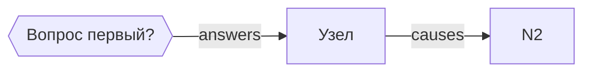

# The graph file — format v1

A graph is a Markdown file. It must be readable by a human without tools and parseable by
`scripts/graph_lib.py` without guessing. This file is the contract.

## Skeleton

```markdown
# Граф «Название»

## Метаданные
- задача: одна строка, что за работа
- бюджет узлов: 40
- части: 10

## Корневые вопросы
1. **Вопрос первый?**
2. **Вопрос второй?**

Оси: дипломатия · операция · экономика

## Мастер-граф


## Узлы
| id | что | ось | почему важно | подтверждено | когда |
|---|---|---|---|---|---|

## Рёбра
| от | тип | к | что это значит |
|---|---|---|---|

## Переход в план
| часть | тема | узлы |
|---|---|---|
```

## Node table — six columns, all required

`| id | что | ось | почему важно | подтверждено | когда |`

- **id** — `N` and a number, stable across edits: the plan cites it, so renaming breaks the plan.
- **что** — one line, a claim or a noun phrase.
- **ось** — one of the axes declared in the file. A node that fits no axis is cut or the axis is added.
- **почему важно** — the reader's stake in one sentence.
- **подтверждено** — source, archive, file, command, or a named document. **No anchor, no node.**
- **когда** — date, period, place, or version.

A cell may not contain a pipe character. Write `или` instead of `|`.

## Edge table — four columns

`| от | тип | к | что это значит |`

Types between nodes: `causes`, `contrasts`, `repeats`, `contradicts`.
`answers` connects a root question to its node and is the only type allowed to start at a `Q` id.

## Mermaid block

Same facts, drawn. The block and the table must agree: `check_graph.py` compares them and fails on a
node that exists in one and not the other. Edges may be written as `A -- causes --> B` or bare
`A --> B`; a bare edge is an error, because it has no type.

Questions are declared `Q1{{"текст"}}` (hexagon) and nodes `N1["текст"]` (box).

## The plan-mapping table (optional but recommended)

`| часть | тема | узлы |` — the last column lists node ids separated by commas. `graph_to_plan.py`
compiles units from this table; without it, it falls back to one unit per node.

## Why this format and not JSON

JSON is machine-first: a person cannot open it, a merge conflict is unreadable, and the review of a
graph becomes a review of brackets. Markdown with tables survives review, diffs cell by cell, and still
parses in fifty lines of Python. The JSON form exists only while a script is running.
