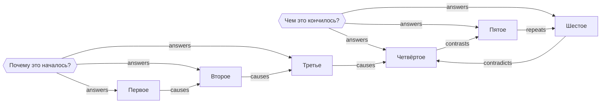

# Граф «Мини-пример для тестов»

## Метаданные
- задача: проверить разбор и проверки на маленьком графе
- бюджет узлов: 10
- части: 2

## Корневые вопросы
1. **Почему это началось?**
2. **Чем это кончилось?**

Оси: причины · следствия

## Мастер-граф

## Узлы

| id | что | ось | почему важно | подтверждено | когда |
|---|---|---|---|---|---|
| N1 | первое событие | причины | задаёт тон | архив, дело 1 | 1901 |
| N2 | второе событие | причины | объясняет первое | архив, дело 2 | 1902 |
| N3 | третье событие | причины | закрывает цепочку | архив, дело 3 | 1903 |
| N4 | первое следствие | следствия | видно читателю | отчёт, стр. 4 | 1904 |
| N5 | второе следствие | следствия | спорно | отчёт, стр. 5 | 1905 |
| N6 | третье следствие | следствия | итог | отчёт, стр. 6 | 1906 |

## Рёбра

| от | тип | к | что это значит |
|---|---|---|---|
| Q1 | answers | N1 | узел отвечает на первый вопрос |
| Q1 | answers | N2 | узел отвечает на первый вопрос |
| Q1 | answers | N3 | узел отвечает на первый вопрос |
| Q2 | answers | N4 | узел отвечает на второй вопрос |
| Q2 | answers | N5 | узел отвечает на второй вопрос |
| Q2 | answers | N6 | узел отвечает на второй вопрос |
| N1 | causes | N2 | первое вызвало второе |
| N2 | causes | N3 | второе вызвало третье |
| N3 | causes | N4 | третье вызвало следствие |
| N4 | contrasts | N5 | два разных исхода |
| N5 | repeats | N6 | тот же механизм позже |
| N6 | contradicts | N4 | источники расходятся |

## Переход в план

| часть | тема | узлы |
|---|---|---|
| 1 | начало | N1, N2, N3 |
| 2 | итог | N4, N5, N6 |
